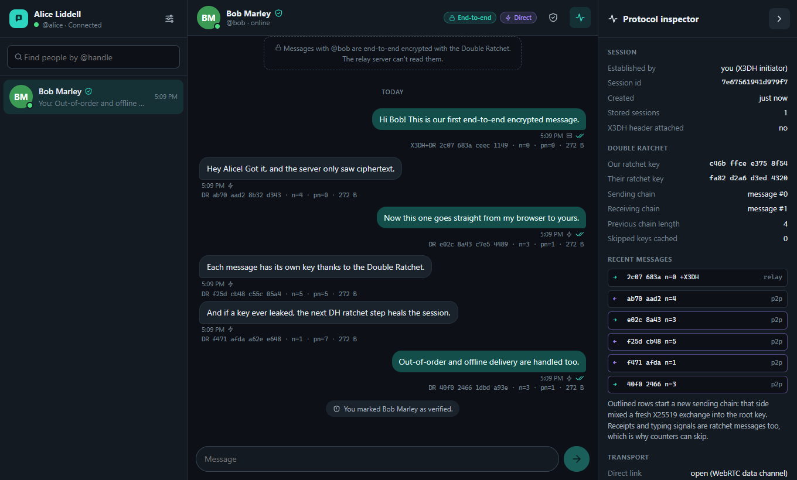
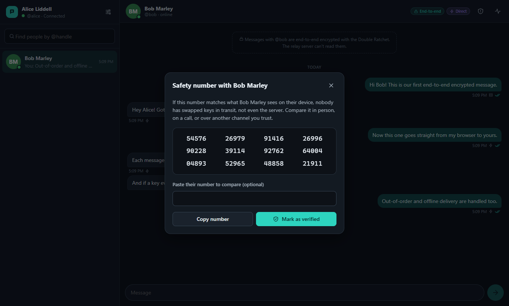
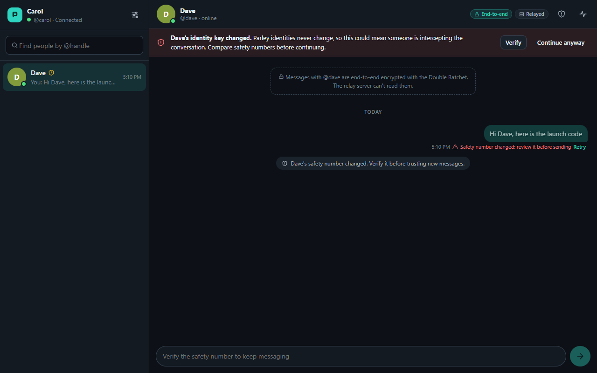
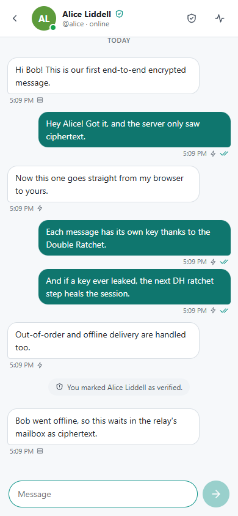

# Parley: end-to-end encrypted, peer-to-peer chat

Parley is a browser messenger where the server never sees a message. Keys are generated in the browser. Conversations are encrypted with an X3DH handshake and the Double Ratchet. When both people are online, messages travel **directly between browsers over WebRTC data channels**. When someone is offline, the server only stores opaque ciphertext until they return.



## Highlights

- **My own implementation of the Signal-style protocols** ([`packages/crypto`](packages/crypto/src)), built on the audited [noble](https://paulmillr.com/noble/) primitives:
  - X3DH key agreement with signed and one-time pre-keys
  - a Double Ratchet that handles out-of-order delivery, with a bounded cache of skipped message keys
  - multiple sessions per peer, so two people who start a conversation at the same moment end up in one session
  - length-hiding padding
  - 60-digit safety numbers
- **Peer to peer first.** WebRTC data channels connect the browsers directly, and offer collisions are resolved with polite and impolite peer roles. The server only relays the WebRTC setup messages. If a direct link can't form, messages fall back to an encrypted store-and-forward mailbox.
- **No passwords on the server.** An account *is* an Ed25519 key. To sign in, the browser signs a single-use challenge from the server. Session tokens live only in memory.
- **The server is not trusted with keys.**
  - Clients verify every pre-key bundle signature themselves.
  - They pin each contact's identity the first time they see it.
  - If the server ever swaps an identity, the client blocks sending until the user compares safety numbers.
- **Encrypted at rest.** Private keys, ratchet state, contacts and history sit in IndexedDB, encrypted with AES-256-GCM under a PBKDF2-SHA256 key (600k iterations) derived from your passphrase. Each record's name is bound into the encryption, so records can't be swapped with one another.
- **Metadata minimised.**
  - Read receipts and typing indicators travel *inside* the encryption.
  - Typing indicators are never stored.
  - You only accept direct links from existing contacts, because a direct link reveals your IP address to the peer.
  - A relay-only mode hides your IP completely.
- **Protocol inspector.** You can watch ratchet keys rotate, chain counters advance and X3DH headers disappear after the first reply, live.
- **Tested end to end.**
  - 86 unit tests across the crypto, server and client.
  - 4 Playwright scenarios that drive two real browsers each, including a simulated man-in-the-middle server and simultaneous session setup.

| Verifying a safety number | Server swaps a key: sending is blocked | Mobile, light theme |
|---|---|---|
|  |  |  |

## How it works

```
 Browser A                                    Server                                  Browser B
 ─────────                                    ──────                                  ─────────
 vault (IndexedDB, AES-GCM)                   key directory  (public keys only)       vault
 X3DH + Double Ratchet                        mailbox        (ciphertext only)        X3DH + Double Ratchet
        │                                     signalling + presence (WebSocket)               │
        │ 1. GET /users/:id/bundle ──────────►  hands out one one-time pre-key                │
        │ 2. encrypt (X3DH header + ratchet)                                                  │
        │ 3a. both online ═══════════════ WebRTC data channel (direct) ══════════════════════►│
        │ 3b. otherwise ──── envelope ───────►  stored until B acknowledges ── envelope ─────►│
        │                                                                     4. decrypt, persist, ack
```

1. **Registration.**
   - The browser generates an Ed25519 signing key and an X25519 identity key (signed by the Ed25519 key).
   - It also generates a signed pre-key and 100 one-time pre-keys.
   - It saves all of them to the encrypted vault *before* publishing the public halves.
2. **Starting a conversation.**
   - The sender fetches a pre-key bundle, which uses up one of the recipient's one-time pre-keys, and verifies its signatures.
   - It runs X3DH and attaches an X3DH header to each message until the first reply arrives.
3. **Every message.**
   - Every message gets its own key from the symmetric ratchet.
   - Each change of direction mixes a fresh X25519 exchange into the root key.
   - A ratchet step is saved together with the message it produced before anything is sent, so a crash can never reuse a message key.
4. **Delivery.**
   - The same encrypted envelope goes over whichever transport is available.
   - Duplicates are detected by envelope hash, so a redelivery is harmless.
   - Mailbox entries are deleted only after the recipient has decrypted the message and saved it.
5. **Upkeep.**
   - Clients top up their one-time pre-keys when the server reports they are running low.
   - They rotate the signed pre-key weekly and keep older ones for 30 days so late first messages still decrypt.

The full protocol, the wire formats and the threat model are in [docs/PROTOCOL.md](docs/PROTOCOL.md).

## Project layout

```
packages/crypto   X3DH, Double Ratchet, sessions, safety numbers, padding (TypeScript, no DOM)
server            Fastify + node:sqlite: directory, challenge auth, mailbox, signalling, presence
web               React client: vault, key upkeep, socket, WebRTC links, UI
e2e               Playwright scenarios with two independent browser profiles
```

**Stack:**

- **Language and runtime:** TypeScript everywhere, on Node 24. The server runs its `.ts` files directly using Node's built-in type stripping, so there's no build step.
- **Server:** Fastify 5 and SQLite (`node:sqlite`).
- **Web client:** React 19 and Vite.
- **Tests:** Vitest and Playwright.

## Running it

**Docker** (one container serves the API and the web app):

```bash
cp .env.example .env
docker compose up -d --build
# open http://localhost:8080 in two different browser profiles and create two accounts
```

**Local development** (Node 22.18 or later; 24 recommended):

```bash
npm install
npm run dev --workspace server   # API on :8787
npm run dev --workspace web      # UI on :5173, proxies /api to :8787

npm test             # unit tests for all packages
npm run typecheck
npm run e2e          # builds the client and runs the Playwright suite
                     # (PW_CHANNEL=msedge or chrome to use an installed browser)
```

To get direct links between machines on different networks, give the browsers STUN and TURN servers through `PARLEY_ICE_SERVERS`, for example `[{"urls":"stun:stun.l.google.com:19302"}]`. Without them, links only form between peers that can reach each other directly. Everything else keeps working over the relay.

## Configuration

| Variable | Default | Purpose |
|---|---|---|
| `PARLEY_PORT` | `8787` | HTTP / WebSocket port |
| `PARLEY_DB` | `./data/parley.sqlite` | SQLite database path |
| `PARLEY_STATIC_DIR` | – | serve the built web client from this directory |
| `PARLEY_ICE_SERVERS` | `[]` | STUN/TURN servers handed to browsers (JSON) |
| `PARLEY_SESSION_TTL_HOURS` | `168` | lifetime of a sign-in token |
| `PARLEY_MAILBOX_TTL_DAYS` | `30` | undelivered envelopes are deleted after this |
| `PARLEY_MAILBOX_LIMIT` | `5000` | max queued envelopes per recipient |
| `PARLEY_TRUST_PROXY` | `false` | trust `X-Forwarded-*` (behind a reverse proxy) |

## Limitations

This is a portfolio project. It has not been audited, so don't rely on it to protect anyone.

- **One device per account.** A backup moves the account to a new device. Multi-device support would need per-device identities, as in Sesame.
- **Visible metadata.** The server sees who talks to whom and when. Sealed sender and header encryption would reduce that.
- **Browser-based key storage.** Keys live in the browser, so a malicious server could serve modified JavaScript. Distributing the client as a signed extension or desktop app would close that gap.
- **Single process.** The relay keeps connections in memory. Running more than one instance would need a shared pub/sub layer such as Redis.

## Acknowledgements

The idea comes from the project list in [CarterPerez-dev/Cybersecurity-Projects](https://github.com/CarterPerez-dev/Cybersecurity-Projects). Parley is an independent implementation with its own design and code. The protocols follow the published [X3DH](https://signal.org/docs/specifications/x3dh/) and [Double Ratchet](https://signal.org/docs/specifications/doubleratchet/) specifications.

## License

[MIT](LICENSE)
